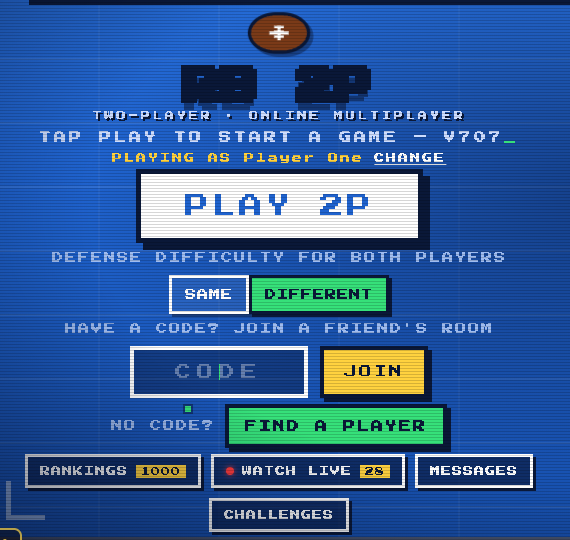
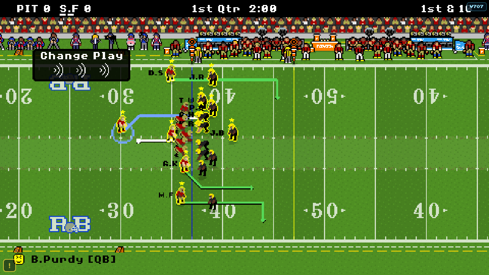

# RB 2P

**Real two-player online football, right in your browser.** Both offenses are played by real people — no computer drives, no waiting for an AI. Pick a team, share a 4-letter code with a friend (or let the game find you an opponent), and play.

### ▶ Play now: **[two-player-rb.vercel.app](https://two-player-rb.vercel.app)**

Works on Chromebooks, phones and computers. No download, no install.

⭐ **Like it? Star this repo** — it's the easiest way to support the game.

---

## What's in it

- **Play a friend** — tap PLAY 2P, send them the room code, both tap READY.
- **Find a player** — no code? Get matched with someone online right now.
- **Rankings** — every ranked game moves your rating. Climb the board.
- **Watch live** — spectate games that are being played right now.
- **Plays of the day & game of the day** — the best plays and games are picked every morning, with full replays.
- **Tournaments** — the World Championship Qualifier: a bracket, seeds and a match day.
- **Messages & challenges** — message players and challenge them from the rankings.
- **Accounts** — a username and password keep your rating on any device. Add an email if you want a way back in when you forget your password (optional).
- **Difficulty** — from easy to MAX, the same for both players or different.
- **Fair play** — leaving a ranked game early costs rating points; point farming is detected and undone.

## Recent updates

| Version | What changed |
|---|---|
| V707 | A full-screen button when the game is embedded in another page |
| V706 | New MAX pass coverage — defensive backs stay level with receivers instead of sitting deep, so MAX is harder and fairer |
| V705 | Optional email on accounts, for resetting a forgotten password |
| V702–V703 | Forgot-password system |
| V699–V700 | Fixed leave penalties hitting the player who stayed; the points were given back |
| V697 | Every old version of the game can be played again |

## About this repo

The game's source code is private. This repository is its public home — screenshots, updates, and the place to ⭐ star it.

Found a bug? Use the **!** button in the bottom-left corner of the game.

*2P version by Soham Sthitpragya.*
